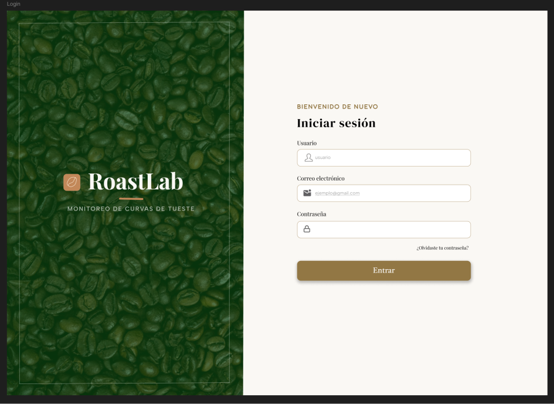
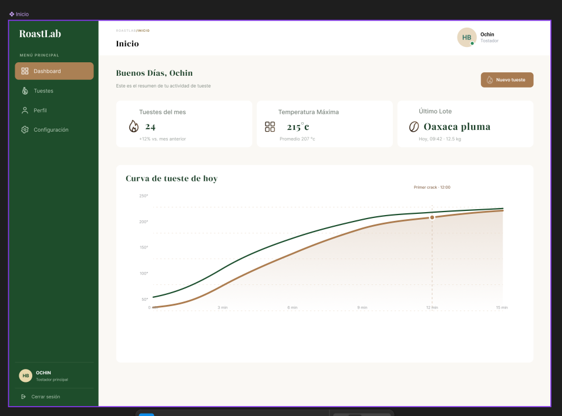
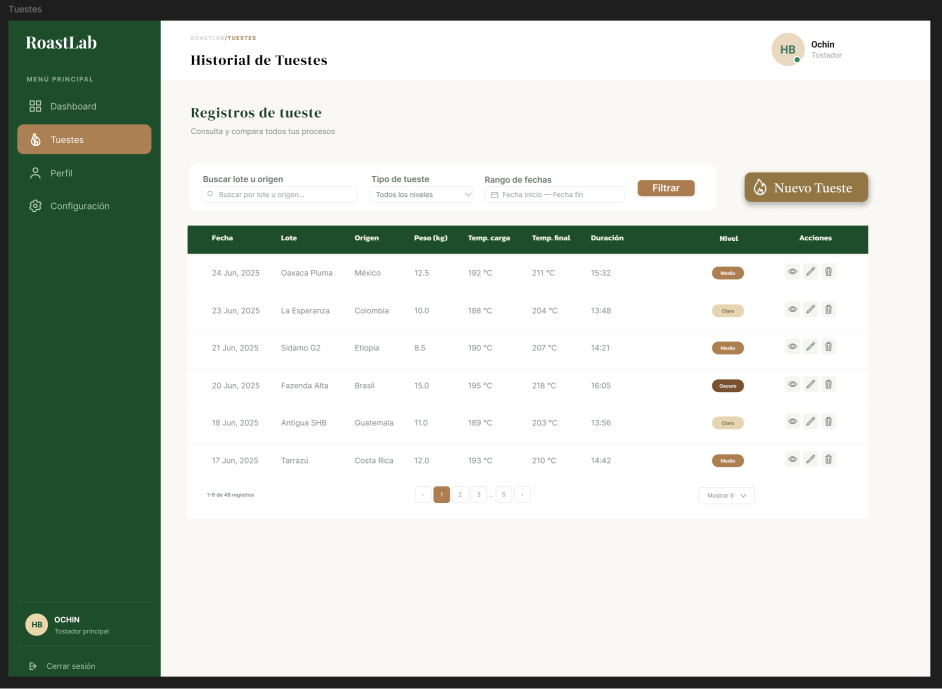

# RoastLab - Act8: Consumo de APIs de terceros (Login y tabla CRUD)

Mini sistema en React (Vite) que simula un login real con la API de DummyJSON y una tabla de productos con filtros, paginación sincronizada con la URL y acciones CRUD.

## Integrantes

- Avendaño Chavéz Nadya Yahuilí
- López Cortés Hayley Brithany

## API elegida para la tabla

DummyJSON Productos: https://dummyjson.com/products
(El login usa https://dummyjson.com/auth/login. Usuario de prueba: `emilys` / `emilyspass`.)

## Proyecto desplegado

aun no hay 

## Ejecutar en local

```bash
npm install
npm run dev
```

## Build de producción

```bash
npm run build
```

Antes del build, `base` en `vite.config.js` debe ser `/t3_act8_eqXX/` (con el número real del equipo).

## Estructura

```
src/
  components/   Sidebar, Navbar, LoginForm, Modal, ConfirmDialog, ProductForm, ProductTable, Filters, Pagination, Toast, Icons
  hooks/        useProducts, useUrlParams
  pages/        Login, Home, Products, Profile, Settings
  services/     authService, productService
  styles/       layout.css, login.css, products.css
```

## Nota

DummyJSON simula las escrituras (POST, PUT, DELETE): la petición se hace de verdad, pero los cambios no persisten en el servidor. Por eso la tabla refleja los cambios con el estado local de React.

## Captura de pantalla

Capturas desde el diseño de la paágina creadas desde Figma Design

1.Login mostrando dos campos, de usuario y contraseña


2.Dashboard princilap que aparece después de logearse


3.Dashboard que muestra una tabla de tuestes



